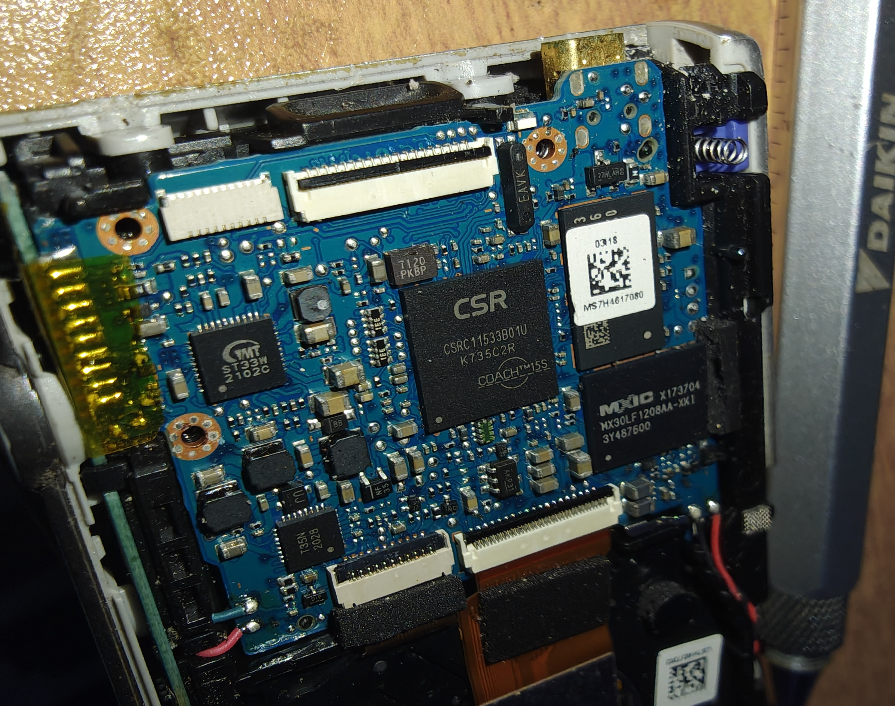

# Sony DSC-W800 — Firmware / Control Reverse Engineering

Investigating whether the **Sony Cyber-shot DSC-W800** can be given manual
exposure control (manual shutter speed, gain, etc.) that the stock firmware
does not expose through its UI.

The camera is built around a **CSR/Zoran COACH 15S** "camera-on-a-chip" — the
same SoC *family* used in the first-generation Lytro light-field camera, which
was [successfully reverse engineered](https://github.com/ea/lytro_unlock) to
expose hidden manual controls over a vendor command channel. That precedent is
what motivated this investigation.

> **Status (corrected 2026-11-02):** The camera's *PTP* interface exposes no
> exposure control, and a Lytro-style SCSI sweep (`0xC0`–`0xFF`) found no
> channel — **but this is not a dead end.** A Sony vendor command channel (SCSI
> opcode **`0x7A`**) and the Sony **updater query protocol** both respond on the
> W800, and the COACH platform ships a **UART debug Monitor** whose command set
> includes `MonitorSetExposure` (manual exposure) and `MonitorNandReadPhysical` /
> `MonitorFlashDumpData` (firmware dump). The most promising route is now the
> **serial Monitor**, not a blind NAND teardown.
>
> *An earlier version of this README concluded "software dead end / no
> remote-control API." That was premature and is **retracted** — see
> [What we actually found](#what-we-actually-found) and
> [the COACH Monitor lead](#the-coach-monitor-lead).*

---

## Hardware

Main board (full resolution: [`images/mainboard.jpg`](images/mainboard.jpg)):



| Ref / marking | Identification | Confidence | Role |
|---|---|---|---|
| `CSR CSRC11533B01U` `K735C2R` `COACH™ 15S` | CSR (ex-Zoran, now Qualcomm) **COACH 15S** SoC | **Confirmed** (silkscreen) | Main processor — sensor pipeline, JPEG, UI, USB. Same COACH family as the Lytro's chip. |
| `MXIC MX30LF1208AA-XKI` `3Y487600` | Macronix **512 Mbit (64M×8) SLC NAND**, 3.3 V, **VFBGA-63** | **Confirmed** (distributor/datasheet) | Holds firmware + the ~29 MB internal memory. Primary dump target — see [hardware plan & pinout](docs/hardware-plan.md). |
| `ST33W 2102C` (TMT logo) | Unidentified | Likely | Probably SDRAM/DRAM or a PMIC. Not yet confirmed. |
| `T35N 2028` | Unidentified | — | Likely power / lens-motor driver. |
| `T120 PKBP` | Unidentified | — | Small discrete / regulator. |
| Shielded module, QR, `360` / `0318` / `MS7H4617080` | Unidentified | — | Shielded sub-assembly — possibly sensor front-end or a DC-DC converter. |

### COACH lineage
Zoran **COACH** ("Camera On A CHip") → **CSR** acquired Zoran (2011) →
**Qualcomm** acquired CSR (2015). The COACH is typically a MIPS core plus an
imaging DSP running a small proprietary RTOS (not Linux). The Lytro used an
earlier Zoran-branded COACH; this is a newer CSR-branded **15S**.

---

## Goal

Expose **manual shutter speed** (and ideally aperture/ND, gain/ISO) on a camera
whose stock firmware offers only `±2 EV` exposure compensation and no manual
mode. The working hypothesis — borrowed from the Lytro result — was that the
COACH firmware already contains internal engineering controls for sensor
integration time and gain, and that they might be reachable through a hidden
command channel without any firmware modification.

---

## Investigation summary

USB enumeration:

```
Bus 001 Device 072: ID 054c:08d4 Sony Corp. DSC-W800
```

The camera offers **Mass Storage** and **MTP/PTP** USB modes (Menu → Setup →
USB Connect). Both were probed. Full command transcripts are in
[`docs/investigation-log.md`](docs/investigation-log.md).

### 1. USB Mass Storage — Lytro-style SCSI sweep → **no channel in `0xC0`–`0xFF`** (incomplete)

The Lytro is driven by **SCSI vendor-specific opcodes** (`0xC0`–`0xC6`) sent
over the USB Mass Storage interface. SCSI reserves the opcode range
`0xC0`–`0xFF` for vendors, so we probed the W800 for an equivalent channel using
[`tools/coach_probe.py`](tools/coach_probe.py) (a read-only SCSI prober written
for this project).

Findings:
- The camera presents **three SCSI LUNs**, all `Sony / DSC / rev 1.00`,
  SPC-2, removable:
  - **LUN 0** → `not ready` = the (empty) memory-card slot.
  - **LUN 1, LUN 2** → `ready` = internal-memory areas.
- Standard INQUIRY / VPD advertise only the standard pages (`00 80 83`) — no
  vendor VPD page.
- **Walking every vendor opcode `0xC0`–`0xFF` (data-in) on both ready LUNs
  returned `ILLEGAL REQUEST / INVALID COMMAND OPERATION CODE`.** No *Lytro-style*
  `0xC0`–`0xC6` channel is present.

➡️ No COACH-style SCSI control channel in the `0xC0`–`0xFF` range. **Caveats
(important):** this sweep does **not** prove "no vendor channel" — it missed Sony
opcode **`0x7A`, which does work** (below the swept range; see
[What we actually found](#what-we-actually-found)); its generic CDB framing and
LUN 1/2 targeting do **not** replicate Lyli's actual Lytro sequence (a specific
12-byte `0xC2` command on LUN 0); and "data-in" specifies a transfer *direction*,
not the absence of camera-side effects, so the probe is **not** truly "read-only
by construction."

### 2. USB MTP/PTP — device properties & operations → **dead end (for control)**

In MTP mode the camera enumerates as a generic *"USB PTP Class Camera"*.
`gphoto2 --summary` / `--list-all-config` report:

- **Vendor Extension ID `0x6` = Microsoft MTP** (`microsoft.com: 1.0;
  microsoft.com/WMPPD: 10.0`) — **not** a Sony vendor extension (Sony's is
  `0x11`).
- **Device Capabilities:** *No Image Capture, No Open Capture, No vendor
  specific capture* — it cannot even trigger the shutter over PTP.
- **Device Properties exposed — only three:** Perceived Device Type (`0xd407`),
  Session Initiator Info (`0xd406`), Battery Level (`0x5001`). **No
  `ExposureTime` (`0x500D`), no `FNumber`, no ISO, no exposure-mode property.**
- Storage: a single 29 MB internal "Builtin RAM" volume, `No File Upload`.

➡️ **PTP is a file-transfer-only interface with no control surface and no Sony
vendor extension.**

## What we actually found

| Vector | Result |
|---|---|
| USB MTP/PTP device properties / ops | Microsoft MTP, file transfer only — **no** exposure control. (Genuine dead end for PTP.) |
| USB Mass Storage, SCSI `0xC0`–`0xFF` | No *Lytro-style* channel in that range (but range was incomplete — see below) |
| **Sony vendor channel, SCSI opcode `0x7A`** | ✅ **Works** — returns model `DSC-W800`, model code `0080816029`, DeviceInfoXML `1.2.02.0730` |
| **Sony updater query protocol** (ext cmd cat 0) | ✅ **Works** — `GET_STATE` (0x200) → state 256; `QUERY_VERSION` (0x20) → version `1.600` |
| PMCA service/senser authentication | ✖️ `StartSenser` + first auth read time out in the tested setup (not proven absent) |

So the camera **does** expose a Sony vendor command transport and an updater
query protocol. No *firmware-read* command has been demonstrated there yet, and
PTP has no exposure control — but "no remote-control API" was wrong.

*(Credit: the `0x7A` / updater results and the review that corrected the original
conclusion come from a parallel investigation; reproduced here honestly.)*

## The COACH Monitor lead

The decisive find comes from offline analysis of a **COACH 15S reference
firmware** (Nikon COOLPIX S3600 — same `CW_C15s` COACHWare SDK; it is a
*reference*, **not** a W800 image and must never be flashed to the Sony). Its
embedded symbol table reveals a full **COACHWare debug Monitor** — an interactive
CLI (`Os/Cli/Monitor.c`) that on the reference runs over **UART port 0 at 115200
8N1** and includes, among ~1000 commands:

- **`MonitorSetExposure`** — direct manual-exposure control (**the goal**).
- `MonitorFlashDumpData`, `MonitorNandReadPhysical`, `MonitorFlashRead`,
  `MonitorDump` — **firmware / memory dump**.
- `MonitorNandWritePhysical`, `MonitorNandBurnImage` — firmware write.
- `MonitorFuncCall` (call any function), **`MonitorGdb`** (GDB stub),
  `MonitorSetJtag`, `MonitorReboot`.

The CLI self-documents: type **`ls`** to list every registered command and
`help <name>` for usage — so the exact tokens don't need to be reversed, only the
monitor reached. `MonitorInit` registers the command lists unconditionally.

**How the monitor is switched on (reference, traced by disassembly).** On the
Nikon image the serial console is enabled by a single **compile-time constant**,
not a strap or runtime probe: `AppInitDebug()` calls `HceGetMonitorType()`
(hardcoded `0x21`) and passes it to `DebugInit()`, which stores the global
`uiMonitorType` and opens the UART. The type is a bitfield — `0x21` = **bit0
(console on) + bit5 (115200 baud)**, port bit clear → **UART 0**. The stdio
backends only touch the UART when `uiMonitorType & 1`. So on the reference the
console is **on by default at UART0, 115200 8N1**.

For the W800 this constant is unknown, and it is binary: **if its bit0 is set**,
the monitor is live at boot and a logic-analyzer sweep of the pads will show
115200 traffic + a prompt; **if clear**, the console is silent and would need a
firmware patch (flip the constant → dump+reflash), the crash/polling
`DebugConsoleMain` path, or the USB route. Visual inspection can't distinguish the
two — only a powered LA/scope sweep of the test points can, which is why "no
obvious UART pins" is inconclusive on its own.

**Confirmed** in the Nikon reference. **Unverified** for the W800 — but it is the
same COACH15S / COACHWare family, so an equivalent Monitor is plausible. If the
W800 exposes it on a UART, `MonitorSetExposure` is a **direct manual-shutter path
with no firmware modification**, and `MonitorNandReadPhysical` dumps the firmware.
The `Burn` write path is wrapped by `BurnHash*` (integrity/possible signature) —
which matters only if one later wants to *flash* modified firmware rather than use
a runtime override.

---

## What's next

The lead is the **UART debug Monitor**, which (if present on the W800) offers both
the goal *and* firmware acquisition without any flashing.

> 📄 **Full procedure, tool list, and the MX30LF1208AA pinout:
> [`docs/hardware-plan.md`](docs/hardware-plan.md).**

1. **Find the UART and look for a Monitor prompt.** Probe test points near the
   COACH at power-on with a logic analyzer / 3.3 V USB-UART adapter. The
   reference runs the Monitor on **UART port 0, 115200 8N1**; sweep
   `115200 → 230400 → 460800 → 921600 → 38400 → 9600` (the reference's baud set)
   if 115200 doesn't decode. A boot log alone yields CPU/endianness and memory
   map. **Reversible, no permanent modification.**
2. **If a prompt appears, type `ls`** to enumerate the registered commands, then
   `help <name>`. Look for the W800's equivalents of `MonitorSetExposure`
   (→ manual shutter, the goal) and `MonitorNandReadPhysical` / `MonitorFlashDumpData`
   (→ firmware dump).
3. **`MonitorSetExposure` first** — a *runtime* exposure override needs no
   reflash and is fully reversible. Validate with EXIF + a timing-sensitive test.
4. **Dump via the Monitor** (`MonitorNandReadPhysical` / `MonitorFlashDumpData`)
   for offline analysis; hash and keep a golden copy. Only if the Monitor is
   absent fall back to a hardware NAND read of the `MX30LF1208AA` (note: the NAND
   holds the *compressed* image).
5. **Ghidra (MIPS)** for deeper work; patch/reflash only as a last resort
   (`Burn` is `BurnHash*`-checked — determine crypto-vs-integrity before relying
   on flashing). **← brick risk.**

### Honest feasibility caveats
- The Monitor evidence is from the **Nikon reference**; W800 applicability,
  reachability, any auth, and the UART pin/voltage are **unverified**.
- Most Monitor command handlers live in a **hardware-VLC-compressed** firmware
  region, so the command tokens aren't statically readable — but the live `ls`
  makes that moot on a running device.
- The sensor/ISP pipeline may still constrain exposure range; `BurnHash*` may
  gate reflashing. A **sacrificial second body** is wise before anything
  irreversible.
- COACH tooling is sparse; [Sony-PMCA-RE](https://github.com/ma1co/sony-pmca-re)
  targets BIONZ/PMCA bodies and does **not** apply to COACH.

### Help wanted
- Identification of the `ST33W`, `T35N`, `T120` parts and the shielded module.
- Location of the UART pads on the W800 board, and whether a Monitor prompt
  appears.
- A W800 firmware dump and its container/update format.
- Whether `MonitorEnalbePrintOnUsbCommand` implies a USB-reachable monitor path.

---

## Repository layout

```
.
├── README.md                     This file
├── images/
│   └── mainboard.jpg             Main board / COACH 15S SoC photo
├── tools/
│   └── coach_probe.py            Read-only SCSI vendor-opcode prober (Linux, stdlib)
└── docs/
    ├── investigation-log.md      Raw command transcripts (USB, SCSI, PTP)
    └── hardware-plan.md          UART hunt, NAND dump, MX30LF1208AA pinout, Ghidra, reflash
```

### `tools/coach_probe.py`
A dependency-free (Python stdlib, Linux `SG_IO` ioctl) SCSI prober used to test
for a Lytro-style COACH vendor channel over USB Mass Storage. It issues only
data-in / no-data commands and no *known* write/erase opcode. **Caveat:** data-in
specifies a transfer direction, not the camera-side effect of an *unknown* vendor
opcode, so it is **not** guaranteed side-effect-free; it also only sweeps
`0xC0`–`0xFF` (and so misses Sony's working `0x7A`). Treat it as an exploratory
probe, not a safety guarantee.

```bash
sudo python3 tools/coach_probe.py --list                       # find the camera's /dev/sgN
sudo python3 tools/coach_probe.py --device /dev/sgN            # safe identification pass
sudo python3 tools/coach_probe.py --device /dev/sgN --probe-vendor   # walk 0xC0..0xFF (remove SD card first)
```

---

## References

- [ea/lytro_unlock](https://github.com/ea/lytro_unlock) — reverse engineering of
  the Lytro COACH camera (the SCSI/`0xC0`–`0xC6` command model this project
  tested for).
- [ea/lytroctrl](https://github.com/ea/lytroctrl) — Python control library for
  the Lytro (command/transaction framing reference).
- [Lytro Meltdown](https://optics.miloush.net/lytro/) — Jan Kučera's COACH
  protocol & firmware documentation.
- [ma1co/Sony-PMCA-RE](https://github.com/ma1co/sony-pmca-re) — Sony camera RE
  toolkit (applies to BIONZ/PMCA bodies, **not** COACH — documented here for
  completeness).
- [jam1garner/wb35f-research](https://github.com/jam1garner/wb35f-research) —
  Samsung WB35F, another COACH-family reverse-engineering effort.
- Nikon COOLPIX S3600 firmware (v1.2) — the COACH 15S / COACHWare reference image
  whose embedded symbols revealed the Monitor. Used offline as a platform
  reference only; **not** a W800 payload.

---

*This is an independent reverse-engineering / repair-and-tinker project on
hardware the author owns. Modifying camera firmware can permanently brick the
device and voids any warranty.*
